# step-flow

[English](README.md) | **한국어**

채팅 옆에 패널을 추가하는 Claude Code mod입니다. 오래 걸리는 자동 작업 중에 끝난 단계를 하나씩 기록합니다. 채팅을 스크롤하지 않고도 지금까지 한 일과 직접 결정할 사항, 중단된 작업을 확인할 수 있습니다.

## 데모

기본 사용법입니다.



Claude가 결정을 요청하는 경우입니다.



## 설치

Claude Code 터미널 세션의 프롬프트에서 실행합니다.

```
/plugin install step-flow --marketplace joshyeom/step-flow
```

마켓플레이스를 추가할지 물으면 `y`를 입력한 뒤 범위를 선택합니다.

셸에서는 다음 명령을 실행합니다.

```
claude plugin install step-flow --marketplace joshyeom/step-flow
```

`/plugin`이 실행되지 않는 데스크톱 앱에서는 프롬프트 입력란 옆의 +를 누르고 Plugins, Add marketplace를 차례로 선택합니다. 마켓플레이스에는 `joshyeom/step-flow`를 입력하고 Add plugin을 누릅니다.

전체 화면 터미널 레이아웃에서는 패널이 채팅 옆에 표시됩니다.

## 사용법

- `/flow`를 실행하면 패널이 열립니다.
- Claude는 의미 있는 단계가 끝날 때마다 단계를 기록합니다.
- 목록에는 단계마다 시각, 제목, 결과가 나옵니다.
- 단계를 누르면 상세 화면이 열립니다.
- 패널 아래쪽 질문 입력란에서 작업 내용을 물어볼 수 있습니다.

## 단계 결과

| 결과 | 의미 | 목록에 표시되는 내용 |
| --- | --- | --- |
| `성공` | 처음에 성공했거나, 실패했다가 Claude가 고쳤습니다. | 고친 단계는 행 아래에 문제와 조치가 나옵니다. 나중에 고친 단계는 초록색으로 바뀌고, 해결한 시각과 함께 이력이 남습니다. |
| `보류` | 실패했고 고치지 못했지만, 나머지 작업은 막지 않습니다. | 원인과 넘어간 이유가 나옵니다. |
| `중단` | 실패했고 고치지 못했으며, 이 단계에 의존하는 작업이 멈췄습니다. | 원인과 `진행하지 못한 작업` 목록이 나옵니다. |
| `결정 필요` | 사용자가 직접 결정해야 할 때나 보류 또는 중단 단계에 선택지가 있을 때 표시됩니다. | 단계에 `결정 필요`가 표시됩니다. Claude는 이 선택과 무관한 작업을 계속합니다. |
| `결정됨` | 결정 단계에서 사용자가 선택했습니다. | 사용자가 고른 선택지가 나옵니다. |
| `선택됨` | 보류 또는 중단 단계에서 사용자가 선택했습니다. | 실제로 해결됐을 때만 초록색으로 바뀝니다. |

요약 줄은 `단계 N개, 결정 필요 K개, 중단 M개, 보류 J개` 형식으로 나옵니다.

## 상세 화면

단계를 누르면 다음 내용이 나옵니다.

- 원인, 시도한 방법과 그 이유, 조치
- Claude가 그 단계에서 호출한 도구(Bash 명령, 읽거나 수정한 파일, 검색). `한 일`에 나옵니다.
- Claude가 남긴 메모. `상세`에 나옵니다.

결정 단계의 상세 화면에는 쟁점, 선택지별 의미, 그동안 Claude가 하는 일이 나옵니다.

## 결정

- `A로 결정`을 누르면 선택이 Claude에게 전달됩니다. 보류나 중단 단계에서는 버튼 이름이 `A로 진행`입니다.
- 채팅으로 답해도 됩니다.
- 단계를 기록한 지 한참 뒤에 선택지를 누르면 Claude가 현재 상태를 먼저 확인합니다. 문제가 이미 해결됐거나 선택한 내용이 이후 작업과 충돌하면 Claude는 아무것도 바꾸지 않고 선택지를 다시 보여 주며 어떻게 진행할지 묻습니다.
- Claude는 작업이 끝났다고 말하기 전에 아직 결정하지 않은 사항과 중단된 단계를 모두 알려 줍니다.

## 스크롤

- 질문 입력란은 패널 아래쪽에 고정됩니다. `Table` 테마에서는 표 머리글도 고정됩니다.
- 단계 목록은 그 사이에서 마우스 휠이나 PageUp, PageDown으로 스크롤합니다.
- `↑ N`, `↓ N`은 가려진 행이 몇 개인지 알려 줍니다.
- 목록이 패널보다 길면 맨 위와 맨 아래에 이중선이 나옵니다.

## 패널에서 질문하기

- 답변은 세션 기록(transcript)과 단계 로그를 근거로 합니다.
- 세션의 컨텍스트는 바뀌지 않습니다.
- 질문 행의 `✕`를 누르면 질문과 답변이 닫힙니다.

## 명령어

- `/flow`: 패널을 엽니다
- `/flow-theme`: 테마 6가지 중 하나를 고릅니다(`/flow-theme 1`부터 `/flow-theme 7`까지 번호로 지정할 수도 있습니다)
- `/flow-clear`: 기록된 단계와 패널의 질문을 지웁니다

## 언어

패널은 `language` 설정(한국어 또는 영어)을 따릅니다.

## 비용

패널에서 질문할 때마다 세션 기록의 마지막 120,000자까지를 `sonnet` 모델에 보냅니다.

## 알려진 제한

- 방향키로는 패널이 스크롤되지 않습니다.
- Home과 End 키로는 맨 위나 맨 아래까지 가지 않습니다.
- 단계는 현재 세션에서만 보관됩니다.
