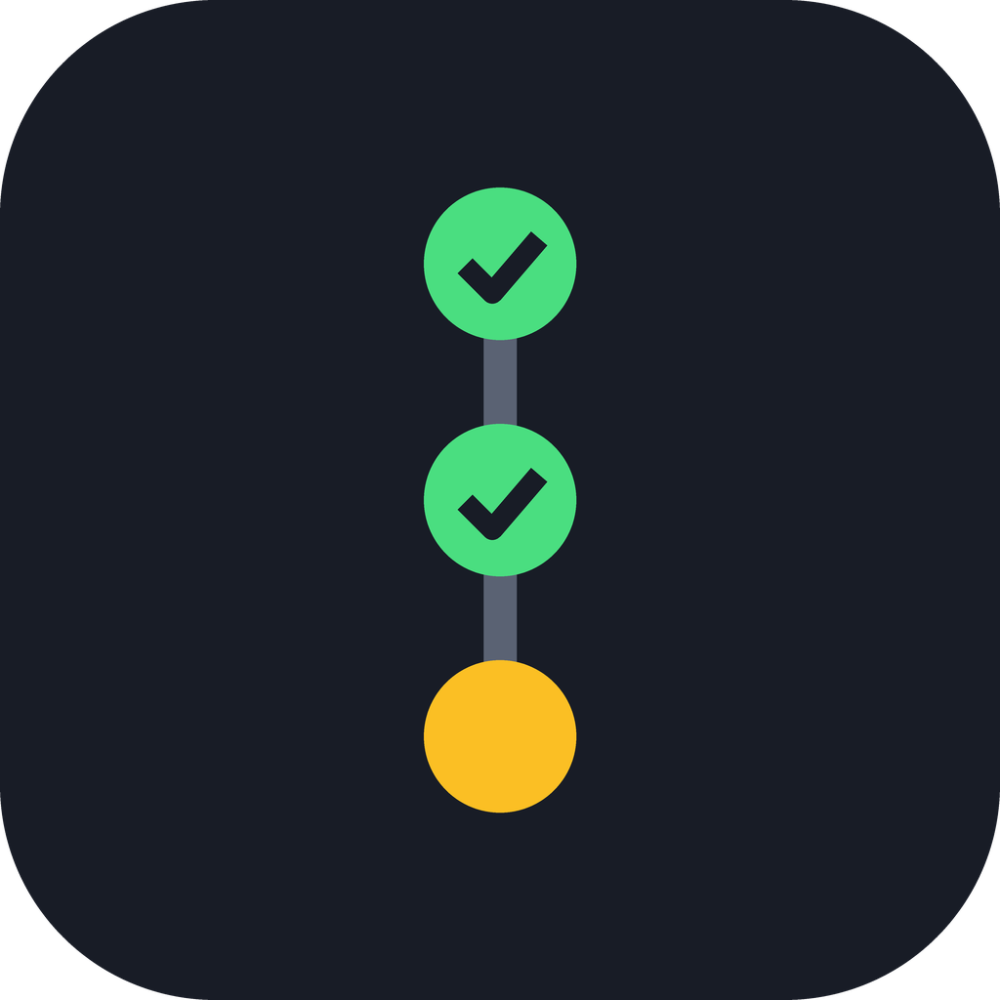

# step-flow

**English** | [한국어](README.ko.md)

A Claude Code mod that adds a side pane. During long autonomous runs it records each finished step, so you can see what happened, what is waiting for your decision and what is blocked, without scrolling the chat.

## Why use it

- **See what Claude Code did at a glance.** The step list shows the work without scrolling the chat.
- **Find bottlenecks and failure causes fast.** Each step records where it got stuck, how it was fixed, or why it failed if it was not.
- **Decide with a click.** When Claude asks for a decision, press an option button in the pane and the choice goes straight to Claude.
- **Ask about a step without touching the context.** Questions typed in the pane are answered by a separate model call, so neither the question nor the answer enters the working Claude's context.

## Demo

Basic use:



When Claude needs your decision:


## Install

At the prompt of a Claude Code terminal session:

```
/plugin install step-flow --marketplace joshyeom/step-flow
```

Answer `y` to add the marketplace, then choose a scope.

From a shell:

```
claude plugin install step-flow --marketplace joshyeom/step-flow
```

In the desktop app, where `/plugin` does not run: click + next to the prompt box, then Plugins, Add marketplace with `joshyeom/step-flow`, then Add plugin.

## Usage

- Run `/flow` to open the pane.
- Claude records a step each time a meaningful step ends.
- The list shows the time, title and result of each step.
- Click a step to open its detail view.
- Use the question input at the bottom to ask about the work.

## Step results

| Result | Meaning | What the list shows |
| --- | --- | --- |
| `Done` | It worked, or it failed and Claude fixed it. | A fixed step shows the problem and the fix under its row. A step fixed later turns green and keeps its history with the time it was resolved. |
| `Deferred` | It failed and is not fixed, but it does not block the remaining work. | The cause and why it was safe to move on. |
| `Blocked` | It failed and is not fixed, and work that depends on it stopped. | The cause and the list of work that could not go on (`Not done`). |
| `Needs decision` | A choice only you should make, or a deferred or blocked step that offers options. | The step is tagged. Claude keeps working on what does not depend on it. |
| `Decided` | You chose on a decision step. | The choice you made. |
| `Chosen` | You chose on a deferred or blocked step. | The step turns green only when it is really fixed. |

The summary line reads `N steps, K to decide, M blocked, J deferred`.

## Detail view

Click a step to see:

- The cause, each attempt with its reason, and the fix.
- Claude's notes, under `Activity`.

For a decision step, the detail view shows the issue, each option with what it means, and what Claude does meanwhile.

## Decisions

- Press `Choose A` to send your choice to Claude. On a deferred or blocked step the button reads `Go with A`.
- You can also answer in chat.
- A choice pressed long after the step was recorded is checked first. Claude looks at the current state. If the step is already fixed or the choice conflicts with later work, Claude changes nothing, reopens the choice and asks you.
- Before Claude says a task is finished, it names every open decision and blocked step.

## Scrolling

- The question input stays in place. In the `Table` theme the table header does too.
- The steps scroll between them with the mouse wheel or PageUp / PageDown.
- `↑ N` and `↓ N` show how many rows are hidden.
- When the list is longer than the pane, a double rule marks the very top and the very bottom.

## Questions in the pane

- Answers come from the session transcript and the step log.
- The session's context is not changed.
- The `✕` on the question row closes the question and its answer.

## Commands

- `/flow`: open the pane
- `/flow-theme`: pick one of six themes (or `/flow-theme 1` to `/flow-theme 7`)
- `/flow-clear`: clear the recorded steps and the pane question

## Pane position

- Claude Code, not step-flow, decides where the pane goes.
  - In the fullscreen layout on a terminal 110 columns or wider, it docks on the right of the chat.
  - Otherwise it sits above the prompt, at the bottom of the screen.
- So when `~/.claude/settings.json` has no `tui` value, step-flow writes `"tui": "fullscreen"` there and shows a notice.
  - From the next session the pane docks on the right.
  - If you set `tui` yourself, step-flow leaves it alone.
- To switch in the current session, run `/tui fullscreen`.

## Step recording reminder

- Each time you send a message, step-flow attaches a hidden reminder that tells Claude to record each step as it finishes.
  - It is not shown in the chat; only Claude reads it.
- It does not go in the system prompt because of machines with organization managed settings.
  - On such machines Claude Code's security plugin `cc-plugin-sec-default` skips user plugins' system prompt hooks (`prompt.compose`, `prompt.context`, `prompt.section`, `prompt.attachment`) and the settings read hook (`settings.read`).
  - Up to 0.3.0 the reminder never reached Claude there, so long runs missed steps.
  - If the chat kept showing "its prompt.compose hook was skipped", this was the case.

## Language

- The pane follows the `language` setting (Korean or English). Without it, it checks the `LANG` and `LC_ALL` environment variables.
- If the language was not set at session start, the pane reads it from the settings when it first draws.
  - Up to 0.3.0 it was set only at session start, and some sessions showed English despite a Korean setting.

## Cost

Each question in the pane sends up to the last 120,000 characters of the session transcript to the `sonnet` model.

## Known limits

- Arrow keys do not scroll the pane.
- Home and End do not reach the very top or bottom.
- Steps are kept for the current session only.
- The cause of the English pane in 0.3.0 was not reproduced. If 0.4.0 still shows English, please open an issue.
